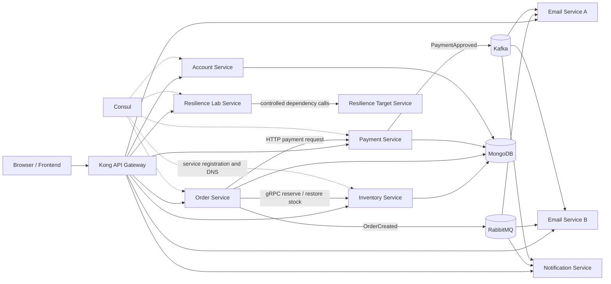

# Beyond Microservices — Live Labs

An educational microservices project for the Dev Weekends technical talk, **Beyond Microservices: Real Engineering Challenges**. It turns distributed-systems concepts into local, repeatable experiments: each lab has a real request path, a controlled condition, and a visible result in the browser.

The project is for learning and demonstrations. Payments, balances, failures, and traffic conditions are simulated; they are not production financial or traffic-management systems.

## Architecture

Browser traffic enters through Kong. Services register with Consul and use its DNS names for internal HTTP discovery. MongoDB stores service data, while RabbitMQ and Kafka demonstrate two messaging styles.



### Services

| Component | Responsibility |
| --- | --- |
| Frontend | Structured Labs Dashboard and Focus Mode at port 3000. |
| Kong | Public `/api/...` routing, Email Service load balancing, and a local rate-limit policy. |
| Consul | Local service registration, health checks, and DNS discovery. |
| Inventory Service | Product API, MongoDB catalog, and gRPC stock reservation/restoration. |
| Order Service | Order workflow, Saga coordination, RabbitMQ `OrderCreated` publisher. |
| Payment Service | Simulated charges, MongoDB payment records, Kafka `PaymentApproved` publisher, and idempotency lab. |
| Email Service A / B | Competing RabbitMQ consumers and Kafka email consumer-group members. |
| Notification Service | Independent RabbitMQ and Kafka consumer. |
| Account Service | Event-sourced simulated accounts rebuilt from MongoDB events. |
| Resilience Lab Service | Retry, circuit breaker, bulkhead, and load-shedding experiments. |
| Resilience Target Service | Controlled healthy, slow, and failing responses for resilience and tracing labs. |
| Prometheus, Grafana, Loki, Promtail | Local metrics and log tools for the trace demonstration. |

## Technology stack

- Node.js and Express
- MongoDB and Mongoose
- gRPC with Protocol Buffers
- RabbitMQ and Kafka
- Kong Gateway and Consul
- OpenTelemetry, Prometheus, Grafana, Loki, Promtail, and an external Jaeger instance
- Docker Compose

## Getting started

### Prerequisites

- Docker Desktop with Docker Compose v2
- At least 6 GB of Docker memory is recommended because Kafka, MongoDB, observability tools, and services run together.

### Start the stack

```powershell
docker compose up -d --build
docker compose ps
```

| URL | Purpose |
| --- | --- |
| <http://localhost:3000> | Live Labs dashboard |
| <http://localhost:8000> | Kong proxy; browser API calls use `/api/...` |
| <http://localhost:8500> | Consul UI |
| <http://localhost:15672> | RabbitMQ Management UI (`admin` / `admin`, local development only) |
| <http://localhost:9090> | Prometheus |
| <http://localhost:3001> | Grafana (`admin` / `admin`, local development only) |
| <http://localhost:16686> | Jaeger UI when a compatible local Jaeger instance is running |

Stop the stack with:

```powershell
docker compose down
```

Named volumes survive `docker compose down`. Use `docker compose down -v` only when you intentionally want to delete MongoDB and observability data.

### Configuration notes

- `RESILIENCE_LABS_ENABLED=true` enables controlled local resilience endpoints.
- `IDEMPOTENCY_LAB_ENABLED=true` enables the local payment idempotency lab.
- Kong reads [kong/kong.yml](kong/kong.yml) during startup. Restart or recreate Kong after changing that file.
- Jaeger is not started by this Compose file. The tracing services export OTLP data to their configured host endpoint.

## Labs overview

| Area | Lab | Observable behavior | Status |
| --- | --- | --- | --- |
| Communication | API Gateway | Kong routing and Email Service round-robin load balancing | Implemented |
| Communication | RabbitMQ | `OrderCreated` routing and competing email consumers | Implemented |
| Communication | Kafka | `PaymentApproved`, consumer groups, and independent consumers | Implemented |
| Data consistency | Saga | Inventory compensation after a controlled order/payment failure | Implemented |
| Data consistency | Idempotency | Lost response, duplicate effect risk, and idempotency-key reuse | Implemented |
| Resilience | Retry | Bounded attempts with exponential backoff and jitter | Implemented |
| Resilience | Circuit breaker and timeout | Three failures open the breaker; a recovery probe closes it | Implemented |
| Resilience | Bulkhead | Separate caller-side capacity pools for different dependencies | Implemented |
| Resilience | Rate limiting | Kong policy of five requests per minute per client IP | Implemented |
| Resilience | Load shedding | Three active operations allowed; excess receives `503` | Implemented |
| Additional | Event sourcing | Immutable account events, ledger, replay, reconstructed balance | Implemented |
| Observability | Traces, logs, metrics | OpenTelemetry trace demo, structured logs, Prometheus and Grafana | Implemented |

## Running the labs

### Commerce, Saga, RabbitMQ, and Kafka

1. Open **Commerce workflow** and add a product.
2. Create an order. Inventory is queried over HTTP and stock is reserved through gRPC.
3. Open **RabbitMQ** to see `OrderCreated` consumers.
4. Pay a pending order, then open **Kafka** to see `PaymentApproved` consumers.
5. For Saga compensation, select the controlled failure checkbox before creating an order. Stock is restored after the failure.

### Idempotency

Open **Idempotency**, create a dummy account, choose protection on or off, send a payment while losing the response, and retry the same logical payment. Compare saved effects and remaining balance. This lab is isolated from normal checkout payments.

### Retry

Choose temporary, persistent, or permanent failure and run the experiment. The timeline shows actual target responses, exponential backoff, jitter, and the final outcome. Only transient `503` and network failures are retried.

### Circuit breaker and timeout

Reset the lab, then send three deliberate failures or three slow requests. Slow target calls take five seconds but time out after three seconds in the caller. At three failures the breaker opens for ten seconds and rejects calls before contacting the target. After the countdown, send a successful request as the HALF-OPEN recovery probe.

### Bulkhead

Click **Send 5 Recommendations + 1 Payment**. The Lab Service allows two slow recommendation calls and one separate simulated payment call. Extra recommendation calls receive `503`, while payment retains its own slot.

### Rate limiting

Open **Rate limiting** in the API Gateway workspace and click **Send Rate-Limit Request** repeatedly. Kong accepts up to five requests in its current one-minute IP window and then returns `429`. The screen displays the real remaining quota or retry time when Kong supplies it.

### Load shedding

Click **Send 10 Simultaneous Requests**. The Lab Service admits three operations and sheds the rest with `503` before they start. Once admitted operations finish, capacity becomes available again. This is a local fixed concurrency threshold, not adaptive CPU-based shedding.

### Event sourcing

1. Open **Event sourcing** and click **Open Demo Account**.
2. Deposit `100`, withdraw `30`, then deposit `50`.
3. The balance becomes `USD 120.00`; the ledger shows each persisted event, sequence, amount, timestamp, version, and resulting balance.
4. Click **Replay Events**. The browser reads the stored events in sequence order and rebuilds the balance from zero.
5. The final panel compares the reconstructed value with the Account Service value. Replay performs no writes.

### Observability

Use **Observability** to send a normal or controlled-failure trace. Search Jaeger for `resilience-lab-service` and `POST /trace-demo`. Open the supplied Grafana dashboards for trace-demo metrics and logs. Health checks are excluded from the custom trace-demo metrics.

## Focus Mode and presentation use

Choose a lab from the left navigation. The URL hash identifies the workspace, so `http://localhost:3000/#event-sourcing` opens Event Sourcing directly. **Focus mode** hides the sidebar for projector use without reloading a lab, changing state, or issuing duplicate requests. Press `Escape` to leave Focus Mode.

## Reliability boundaries and limitations

- Money, payments, and account balances are simulated data.
- Saga failures and resilience failures are controlled local scenarios.
- Account events are append-only through the application API. A unique `(accountId, sequence)` index preserves ordered event streams.
- The browser Event Sourcing lab supplies a client command ID. Retrying that same ID returns the existing saved event. Legacy API callers may omit it, but then a repeated HTTP request is a new command and has no duplicate-effect protection. Different simultaneous commands can conflict on the current version; one may receive `409` and should be refreshed/retried deliberately.
- Event sourcing replays the entire stream on reads. It has no snapshots and is intended for small learning histories.
- Bulkhead and load-shedding counters are in-memory limits for one Lab Service instance, not distributed coordination across replicas.
- Kong rate limiting uses local in-memory storage and client IP, not a shared multi-gateway production quota.
- Docker Compose is a local topology, not a production deployment, service mesh, or Kubernetes configuration.
- Jaeger is external to this Compose file. Prometheus, Grafana, Loki, and Promtail are included locally.

## Development and testing

Rebuild only services affected by a change:

```powershell
docker compose up -d --build --no-deps account-service frontend
```

Run focused integration tests against the local gateway:

```powershell
node account-service/tests/event-sourcing.integration.js
node payment-service/tests/idempotency-lab.integration.js
node resilience-lab-service/tests/resilience-labs.integration.js
```

Tests create local demo records and do not delete existing MongoDB data. Syntax checks:

```powershell
node --check frontend/public/app.js
node --check account-service/routes/account-routes.js
```

## Project structure

```text
frontend/                    Dashboard UI and Focus Mode
kong/                        Declarative Kong routes and rate-limit policy
account-service/             Event store, replay rules, Account API
inventory-service/           Product API and stock gRPC server
order-service/               Order workflow, Saga coordinator, RabbitMQ publisher
payment-service/             Charges, Kafka publisher, idempotency lab
email-service/               RabbitMQ and Kafka email consumers
notification-service/        RabbitMQ and Kafka notification consumer
resilience-lab-service/      Retry, circuit breaker, bulkhead, load shedding
resilience-target-service/   Controlled downstream responses and trace target
observability/               Prometheus, Grafana, Loki, Promtail configuration
proto/                       Inventory gRPC contract
shared/                      Service registration, logs, metrics helpers
docker-compose.yml           Local multi-container topology
```

## Useful source locations

- [Account command routes](account-service/routes/account-routes.js)
- [Account replay rules](account-service/events/replay-account.js)
- [Kong routes](kong/kong.yml)
- [Resilience labs](resilience-lab-service/labs)
- [Dashboard application code](frontend/public/app.js)
